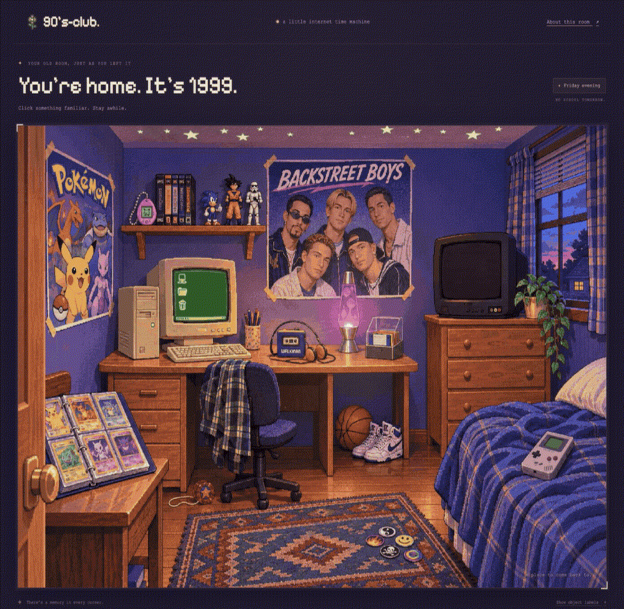
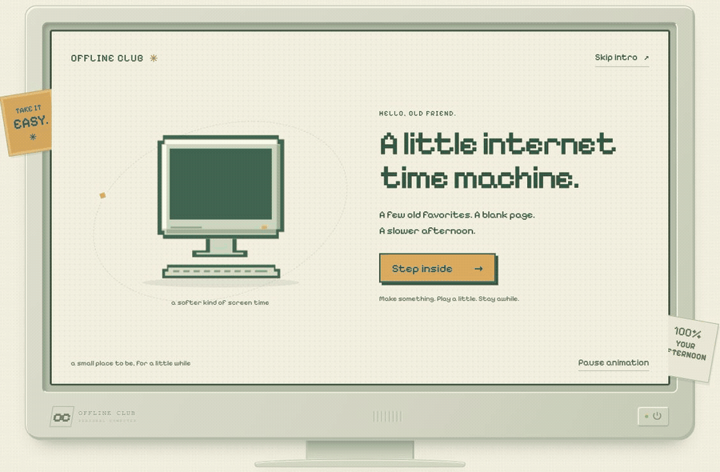

# Offline Club

**You’re home. It’s Friday evening, 1999.**

### [Step inside the bedroom →](https://offline-club-98.btc0days.chatgpt.site)



[View the full bedroom illustration](docs/bedroom-preview.jpg)

The computer is on the desk. Your favourite band is on the wall. There’s a mixtape where you left it, and no school tomorrow. Click something familiar and stay awhile.

[Explore the live room](https://offline-club-98.btc0days.chatgpt.site) · [Browse the source on GitHub](https://github.com/cloudweaver/offline-club)

## Look around

- **The computer:** Snake, Mines, Paddle, Paint Pad, a saved notebook, and Mixtape Radio inside a little windowed desktop. Move, minimize, maximize and reopen its windows.
- **The Walkman and band poster:** eight official music videos from the ’80s and ’90s, including Backstreet Boys, a-ha, TLC and Spice Girls. Flip between mixtape sides or choose another song.
- **The television:** a visible YouTube player with music-video channels and an official Pokémon clip.
- **The Pokémon binder:** six original pixel fan portraits. Turn each card over for a small after-school memory; these are not scans of official trading cards.
- **The virtual pet:** Feed, Play and Nap change your little pal’s mood and meters. It lives for this visit, without an account or saved chores.
- **The handheld:** Pocket Snake, a playable little game in an original handheld-inspired frame.
- **The pogs and lava lamp:** mix the stack, spread out three original designs, pick a favourite, or switch the warm light on and off.

On a phone, swipe sideways to explore the room or use the object shortcuts below it. Keyboard focus reveals the same hotspots. The PC’s short introduction can be skipped and replayed; reduced-motion preferences show a still scene.

## Music, saves and privacy

Choosing a media object requests a **visible YouTube player**; Play controls are also available. Videos use official artist or Pokémon uploads through `youtube-nocookie.com` embeds. The player stays visible, and playback stops when its panel closes, the page is hidden, or the player moves out of view. There is no hidden audio player or background music extraction.

Your browser may require another click on YouTube’s own Play button. Availability, regional restrictions, ads and playback are controlled by YouTube; **Watch on YouTube** is always offered as a fallback. Privacy-enhanced embedding still makes requests to Google when the player loads. See [YouTube’s embedding documentation](https://support.google.com/youtube/answer/171780?hl=en).

For continuous listening, the Walkman also links to **SomaFM Underground 80s** and **90s90s Radio** in their own tabs. Those stations use their own players and policies; no radio streams are embedded or rehosted here.

Games, drawings, notebook and collections run locally as static browser code. Notes and drawings stay in local browser storage when available; clearing site data removes them. The site adds no accounts or analytics, and fonts are bundled locally. Loading the hosted room and watching YouTube require a network connection; this is not a service-worker offline app.

## Open locally

Use Node.js 22+ for checks and Python 3 for the preview server. There are no npm runtime dependencies.

```sh
npm run dev
```

Open `http://127.0.0.1:4178`. The complete website lives in `dist/` and can be hosted as static files.

```sh
npm run check
npm test
```

The checks validate JavaScript syntax. Tests cover Snake movement and collisions, Mines placement and flood reveal, and Paddle collision and scoring logic.

<details>
<summary>A peek inside the PC — an earlier desktop demo</summary>



The bedroom now surrounds this little desktop. [View its still preview](docs/desktop-preview.jpg).

</details>

## Source, art and hosting

- `dist/modules/bedroom.js` and `bedroom.css`: the room and interactive hotspots.
- `dist/modules/media.js` and `media.css`: official visible YouTube embeds and mixtape controls.
- `dist/modules/collections.js` and `collections.css`: binder, virtual pet, pogs and handheld.
- `dist/app.js`, `styles.css`, `modules/games.*` and `modules/apps.*`: the desktop, games, paint and notebook.
- `dist/assets/bedroom-1999.png`: the original room illustration, created with built-in OpenAI image generation from [the art brief](docs/bedroom-art-brief.txt).
- `.openai/hosting.json`: the existing Sites project identity and static deployment directory.

GitHub holds the source. Sites manages the live deployment; pushing to GitHub alone does not deploy the site. Keep the existing Sites project ID when publishing updates.

This is an unofficial nostalgia fan project. Pixel illustrations and games are original; named characters, artists and brands belong to their respective owners. [Historical references](docs/bedroom-references.md) document the room’s inspirations.

Pixelify Sans is bundled from the official [Google Fonts repository](https://github.com/google/fonts/tree/main/ofl/pixelifysans), by the Pixelify Sans Project Authors. Its [SIL Open Font License](dist/assets/fonts/OFL-PixelifySans.txt) is included.
